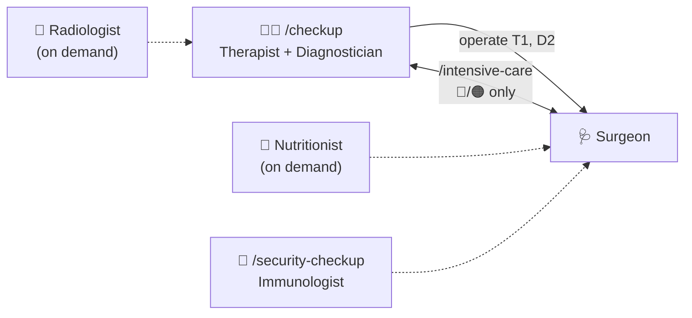

# 🏥 The Code Clinic

> Take care of your code. It will take care of your mental health.


---

## 🧭 Why a clinic?

Most agent workflows (planning, TDD, delegation) act **while** code is being
written. The Code Clinic acts **afterward**: a post-processing safety net that
re-examines the code an agent (or a human) just produced, and catches what
fast development misses.

It is **100% manual**:

- **You decide when** to consult — after a feature, a refactoring, or when the
  code looks sick. The assistant may suggest a checkup in one sentence; it
  never starts one.
- **Diagnostic practitioners never modify code.** They diagnose and prescribe.
- **The Surgeon is the only one who operates**, only on a prescription you
  approved — all of it, or a subset by ID (`operate T1, D2`) — and never more.

No intrusive CI, no judgmental hook, no robot crying in your pull requests.
Just a team of practitioners, available when you call them.

---

## 👨‍⚕️ The team

| Practitioner | Agent | Mode | Question it answers | IDs |
|---|---|---|---|---|
| 🧠 Code Therapist | `therapist` | plan | Is this code well written for its context, and does it do what was asked? | `T1…` |
| 🔬 Test Diagnostician | `diagnostician` | plan | Would these tests catch a regression? Are any tautological, flaky or slow? | `D1…` |
| 🩻 Architectural Radiologist | `radiologist` | plan | Where does the git history say the codebase hurts (churn × coupling, hidden co-changes)? | `R1…` |
| 🥗 Project Nutritionist | `nutritionist` | plan | Should this code exist at all, at this size? | `N1…` |
| 🦠 Immunologist | `immunologist` | plan | What can an attacker actually reach? Every finding has an attack path. | `X1…` |
| 🩺 Surgeon | `surgeon` | build | Executes an approved prescription, batch by batch, against a test baseline. | — |

Every finding has an **ID**, a **location** (`path:line`) the practitioner
actually read, a **severity** (🔴 CRITICAL · 🟠 IMPORTANT · 🟡 MODERATE ·
🔵 MINOR) and a **trade-off** (cost · risk · benefit). The shared contract is
in [`core/clinic-principles.md`](core/clinic-principles.md).

---

## 🩺 Commands

| Command | What happens |
|---|---|
| `/checkup [path… \| branch:<name>]` | The Therapist and the Diagnostician examine the scope in parallel, read-only; one clinical report with a proposed prescription. |
| `/security-checkup [path… \| branch:<name>]` | The Immunologist reviews a change for reachable threats. |
| `/intensive-care [path… \| branch:<name>]` | Checkup → Surgeon → checkup, **only** on actionable 🔴/🟠 findings, until none remain (stops on failure or lack of progress; 10-pass safety cap). |

The Radiologist and the Nutritionist are consulted by name ("ask the
radiologist for this repo's zone of pain", "have the nutritionist look at
`src/billing`"). With no argument, commands examine the current session's
work, or the uncommitted changes.



---

## 📦 Installation

**Claude Code** — as a plugin (recommended):

```bash
claude plugin marketplace add alexandrerodenas/la-clinique-du-code
claude plugin install la-clinique-du-code@la-clinique-du-code
```

**OpenCode**, **GitHub Copilot** (VS Code and the Copilot app), or a manual
Claude Code install — clone this repository, then, on any OS:

```bash
node scripts/install.mjs opencode
node scripts/install.mjs copilot --project /path/to/your/project
node scripts/install.mjs claude
```

**GitHub Copilot CLI** (skills only): `copilot plugin install ./plugin`.

Details, options (`--dry-run`, `--uninstall`) and the install-by-agent prompt:
[**docs/installation.md**](docs/installation.md). Usage guide:
[**docs/usage.md**](docs/usage.md).

---

## 🧩 Architecture

```text
core/        the portable Clinic — the only place to edit
  clinic-principles.md   shared contract (rules, severity, finding format)
  protocols/             8 skills: 6 practitioners + checkup + intensive-care
  agents/                6 practitioner personas with their access level
  tools/                 zone-of-pain analyzer (Node, no dependency)
plugin/      generated Claude Code / Agent Plugins package (+ hand-written commands)
adapters/    OpenCode and Copilot integrations (agents generated, commands hand-written)
scripts/     build.mjs (generate + --check) · install.mjs (cross-platform installer)
tests/       structure, installer and analyzer tests — run with `npm test`
```

Edit `core/`, run `node scripts/build.mjs`, then `npm test`. See
[`core/README.md`](core/README.md).

---

## 📝 License

[MIT](LICENSE) — the Clinic is open to all, care is free.
